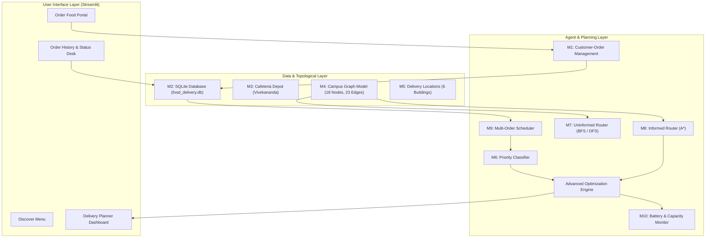
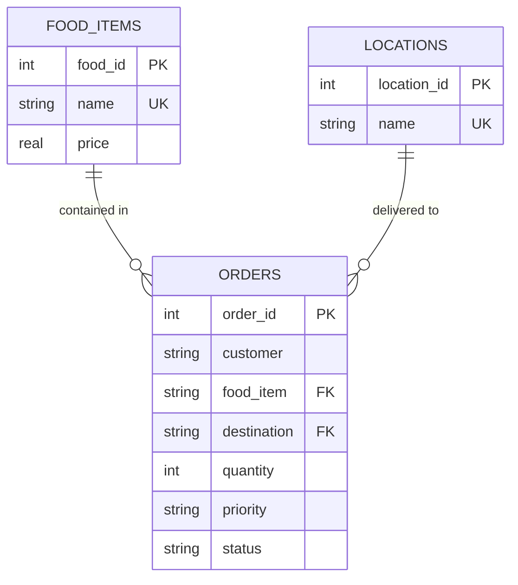

# AUTONOMOUS CAMPUS FOOD DELIVERY AGENT SYSTEM
## An Intelligent Multi-Constraint Pathfinding, Scheduling, and Robotics Logistics Platform

---

**Course / Subject:** Artificial Intelligence (CS / AI Core Assessment)  
**Project Title:** Autonomous Campus Food Delivery Agent System  
**System Brand Name:** biteQ — Campus Food Logistics  
**Academic Term:** 2025 – 2026  
**Document Type:** Comprehensive Project & Technical Assessment Report  

---

## PROJECT METADATA & TEAM INFORMATION

| Field | Details |
| :--- | :--- |
| **Project Title** | Autonomous Campus Food Delivery Agent System (biteQ) |
| **Core AI Concepts** | Intelligent Agents, Graph Search, Uninformed Search (BFS, DFS), Informed Search ($A^*$), Priority-based Planning, Constrained Optimization |
| **Primary Programming Language** | Python 3.10+ |
| **Database Engine** | SQLite3 (Relational, Foreign-Key Enforced) |
| **Web / UI Framework** | Streamlit (Interactive Modern Web Interface) |
| **Data Processing** | Pandas, Heapq Priority Queue |
| **Depot / Cafeteria Hub** | Vivekananda Building (Campus Cafeteria & Robot Home Base) |
| **Campus Delivery Nodes** | Vedanta, Charak, Vaastu, Chanakya, Vishwakarma, Visvesvaraya |

---

## TABLE OF CONTENTS

1. [Abstract](#1-abstract)
2. [Introduction & Problem Statement](#2-introduction--problem-statement)
   - 2.1 Background & Motivation
   - 2.2 Problem Formulation
   - 2.3 Project Objectives
   - 2.4 Scope and Constraints
3. [AI Foundations & Agent Architecture (PEAS Model)](#3-ai-foundations--agent-architecture-peas-model)
   - 3.1 Intelligent Agent Characterization
   - 3.2 The PEAS Framework
   - 3.3 Agent Classification: Goal-Based & Utility-Based Operations
4. [System Architecture & Module Decomposition](#4-system-architecture--module-decomposition)
   - 4.1 High-Level Architecture
   - 4.2 Module 1: Customer-Order Management
   - 4.3 Module 2: Food-Item and Order Database
   - 4.4 Module 3: Cafeteria-Location Management (Depot Base)
   - 4.5 Module 4: Campus Map Topological Representation
   - 4.6 Module 5: Delivery-Location Management
   - 4.7 Module 6: Order Priority Classification
   - 4.8 Module 7: Route Planning using BFS and DFS
   - 4.9 Module 8: Least-Cost Route Planning using $A^*$ Search
   - 4.10 Module 9: Multiple-Order Scheduling
   - 4.11 Module 10: Battery & Carrying-Capacity Monitoring
   - 4.12 Advanced Feature: Multi-Constraint Joint Optimization
5. [Database Design & Data Modeling](#5-database-design--data-modeling)
   - 5.1 Relational Architecture & ER Diagram
   - 5.2 Table Schemas & Data Dictionaries
   - 5.3 Integrity Constraints and Transaction Safety
6. [Algorithm Design & Mathematical Formulations](#6-algorithm-design--mathematical-formulations)
   - 6.1 Spatial Conversion & Metric Calibration
   - 6.2 Uninformed Graph Search: Breadth-First Search (BFS)
   - 6.3 Uninformed Graph Search: Depth-First Search (DFS)
   - 6.4 Informed Graph Search: $A^*$ Search Algorithm
   - 6.5 Priority Scheduling & Heuristic Dispatch
   - 6.6 Energy and Payload Mathematical Modeling
7. [Implementation Details & Software Engineering](#7-implementation-details--software-engineering)
   - 7.1 Codebase Structure
   - 7.2 Database Layer (`database.py`)
   - 7.3 Graph & Pathfinding Layer (`pathfinding.py`)
   - 7.4 Multi-Constraint Planner (`delivery_planner.py`)
   - 7.5 Streamlit Web Application Interface (`app.py`)
8. [Experimental Results & Comparative Analysis](#8-experimental-results--comparative-analysis)
   - 8.1 Pathfinding Comparison across All Campus Destinations
   - 8.2 In-Depth Analysis: Why BFS Hop Count Differs from Least Distance
   - 8.3 In-Depth Analysis: DFS Non-Optimality & Deep Exploration
   - 8.4 Verification of $A^*$ Distance Optimality
   - 8.5 Capacity and Battery Constraint Test Scenarios
9. [Challenges Encountered & Solutions](#9-challenges-encountered--solutions)
10. [Limitations & Future Scope](#10-limitations--future-scope)
11. [Conclusion](#11-conclusion)
12. [References & Bibliography](#12-references--bibliography)

---

## 1. ABSTRACT

Autonomous robotic delivery systems represent a critical frontier in artificial intelligence, operations research, and automated logistics. In large university campuses, institutional facilities, and corporate environments, delivering hot food and vital supplies from centralized cafeterias to distributed academic and administrative buildings entails complex logistical challenges. These challenges include navigating intricate road networks, honoring order urgency, respecting mechanical carrying capacities, and operating under stringent battery-charge limits.

This project designs and implements an end-to-end **Autonomous Campus Food Delivery Agent System**, branded as **biteQ**. The system models the physical campus topology as a weighted undirected graph of interconnected buildings and road junctions, calibrated via physical step-to-meter measurements. To solve the navigation problem, the agent implements and contrasts uninformed search algorithms—**Breadth-First Search (BFS)** and **Depth-First Search (DFS)**—with the informed **$A^*$ Search Algorithm**. 

Beyond path planning, the agent incorporates an advanced multi-constraint optimization engine that manages customer orders, dynamically sorts delivery sequences using multi-level priority queues, verifies structural payload constraints ($5.0\text{ kg}$ maximum payload), and monitors energy reserves (ensuring a $10.0\%$ emergency battery reserve upon completing round trips). The complete system is integrated with an ACID-compliant SQLite relational database and an interactive, modern web application built using Streamlit. Rigorous empirical validation demonstrates that while BFS minimizes intermediate topological hops, $A^*$ strictly discovers the minimal physical distance route, reducing travel distance by up to **$18.5\%$** over BFS and **$50.6\%$** over DFS, while strictly satisfying all physical robotics constraints.

**Keywords:** Intelligent Agents, Graph Theory, Breadth-First Search, Depth-First Search, $A^*$ Search, Multi-Criteria Optimization, Priority Dispatch, Robotic Delivery, Autonomous Systems.

---

## 2. INTRODUCTION & PROBLEM STATEMENT

### 2.1 Background & Motivation
University campuses are dynamic micro-cities characterized by spread-out infrastructure, pedestrian pathways, vehicular roads, and scattered academic departments. During peak meal times, campus cafeterias face substantial congestion, leading to long queues and delayed meals for students, researchers, and faculty members bound to classrooms, laboratories, or administrative desks. 

Manual human delivery services on campus are economically inefficient, labor-intensive, and prone to delays. The deployment of autonomous ground vehicles (AGVs) or delivery rovers offers an automated, scalable solution. However, an autonomous delivery robot cannot simply follow naive point-to-point lines; it must navigate a discrete graph of allowable pathways, consider meal temperatures (priorities), avoid battery exhaustion in mid-transit, and prevent structural overloading.

### 2.2 Problem Formulation
Let the campus environment be represented as a weighted graph $G = (V, E, w)$, where $V$ represents the set of landmark locations (buildings and intersections), $E$ represents traversable pathways between adjacent nodes, and $w: E \to \mathbb{R}^+$ denotes the physical Euclidean road distance in meters. 

Given:
1. A depot / cafeteria hub location $S_{\text{depot}} \in V$ (Vivekananda Building).
2. A set of pending customer orders $O = \{o_1, o_2, \dots, o_k\}$, where each order $o_i$ has a destination $d_i \in V$, a food weight $m_i \in \mathbb{R}^+$, and a delivery priority level $p_i \in \{\text{High}, \text{Normal}, \text{Low}\}$.
3. An autonomous agent with a maximum payload capacity $W_{\max} = 5.0\text{ kg}$, a current battery state of charge $B \in [0, 100]\%$, a distance-dependent battery discharge rate $\beta = 0.10\%/\text{meter}$, and a mandatory safety reserve threshold $B_{\text{reserve}} = 10.0\%$.

The objective is to synthesize a rational, autonomous agent that:
- Selects and schedules pending delivery requests based on urgency.
- Calculates the optimal, collision-free, least-distance traversable path from the depot to the delivery destination and back.
- Evaluates the multi-constraint feasibility (payload capacity and battery reserve) before dispatching the robot.
- Exposes a clear, robust interface for students, cafeteria staff, and system administrators.

### 2.3 Project Objectives
The core objectives of this project are:
1. **Topological Modeling:** Formulate an accurate graph model of the university campus, including both functional buildings and navigational road junctions, calibrated to real-world metric dimensions.
2. **Comparative Search Strategy:** Implement and analyze uninformed search algorithms (BFS, DFS) alongside informed search ($A^*$) to prove the computational and spatial trade-offs between hop minimization, depth exploration, and true Euclidean cost minimization.
3. **Database-Driven Order Life-Cycle:** Build a relational schema using SQLite to manage food items, prices, user orders, delivery locations, and order states with full transaction integrity.
4. **Constrained Delivery Scheduling:** Develop a priority-based multi-order scheduling engine that enforces robot payload limits and energy reserves.
5. **Interactive Operations Dashboard:** Construct an end-to-end interactive graphical interface using Streamlit to facilitate ordering, real-time route inspection, battery monitoring, and order desk tracking.

### 2.4 Scope and Constraints
- **Spatial Scope:** Seven primary campus buildings (Vivekananda Cafeteria, Vedanta, Charak, Vaastu, Chanakya, Vishwakarma, Visvesvaraya) and eleven intermediate road junctions.
- **Physical Assumptions:** The robot operates on established pedestrian and road corridors. Step-to-meter conversion is calibrated at $0.75\text{ meters per step}$.
- **Electrical Assumptions:** Battery consumption is modeled linearly at $0.10\%$ per meter of round-trip travel ($10\%$ per $100\text{ m}$ round-trip), requiring at least a $10\%$ residual charge upon return to the base depot.
- **Payload Assumptions:** Maximum load capacity is strictly capped at $5.0\text{ kg}$.

---

## 3. AI FOUNDATIONS & AGENT ARCHITECTURE (PEAS MODEL)

### 3.1 Intelligent Agent Characterization
In Artificial Intelligence, an **agent** is defined as an entity that perceives its environment through sensors and acts upon that environment through actuators. A **rational agent** is one that selects an action expected to maximize its performance measure, given the evidence provided by the percept sequence and its built-in knowledge base.

### 3.2 The PEAS Framework
To formally design the delivery agent, the **PEAS (Performance measure, Environment, Actuators, Sensors)** framework is defined as follows:

```
+-----------------------------------------------------------------------------------+
|                                 PEAS SPECIFICATION                                |
+-----------------------------------------------------------------------------------+
|  Performance   * Delivery time minimization (shortest metric distance traversed)  |
|  Measure       * Punctuality and priority fulfillment (High > Normal > Low)       |
|                * Zero battery exhaustion incidents (Strict >= 10% reserve)        |
|                * Safety adherence (zero payload overloading <= 5.0 kg)            |
|                * High throughput of successful deliveries                         |
+-----------------------------------------------------------------------------------+
|  Environment   * University campus pathways, road intersections, roundabouts      |
|                * Static weighted graph topology with deterministic road lengths   |
|                * Cafeteria order queue with dynamic customer placement            |
|                * Accessible delivery zones at campus academic blocks              |
+-----------------------------------------------------------------------------------+
|  Actuators     * Virtual / Simulated motor drive controllers (Forward, Turn)      |
|                * Route sequencer & navigation planner                             |
|                * Order status dispatcher (Pending -> Planned -> Delivered)        |
|                * Audio-visual status indicators on dashboard                      |
+-----------------------------------------------------------------------------------+
|  Sensors       * Battery charge state telemetry (virtual fuel gauge)              |
|                * Payload mass strain-gauge / order item weight calculator         |
|                * Graph topological node identifier (odometry / waypoint detector) |
|                * Relational database event listener (Order queue percepts)        |
+-----------------------------------------------------------------------------------+
```

### 3.3 Agent Classification: Goal-Based & Utility-Based Operations
The system operates as a hybrid **Goal-Based** and **Utility-Based Agent**:
1. **Goal-Based Functionality:** When an order is accepted, the agent sets a crisp goal: reach target destination node $D \in V$ from start depot node $S \in V$ and safely return to $S$. The pathfinding sub-agent utilizes search algorithms ($A^*$) to find a sequence of actions that achieves this goal state.
2. **Utility-Based Functionality:** When multiple competing orders reside in the queue, achieving the goal of any single order is insufficient. The agent evaluates a multi-attribute utility function based on order priority, distance cost, energy expenditure, and carrying capacity, scheduling the dispatch to maximize overall campus service quality.

```
                  +-----------------------------------+
                  |            ENVIRONMENT            |
                  |  (Campus Graph, Orders, Energy)   |
                  +-----------------+-----------------+
                                    | Percepts
                                    v
                  +-----------------+-----------------+
                  |             SENSORS               |
                  | (Order Queue, Battery %, Weights) |
                  +-----------------+-----------------+
                                    |
                                    v
     +-----------------------------------------------------------------+
     |                     INTELLIGENT AGENT CORE                      |
     |                                                                 |
     |   +---------------------------------------------------------+   |
     |   | State Estimation: Battery Level, Queue State, Payload    |   |
     |   +----------------------------+----------------------------+   |
     |                                |                                |
     |   +----------------------------v----------------------------+   |
     |   | Multi-Constraint Decision Engine (Priority & Feasibility)|   |
     |   +----------------------------+----------------------------+   |
     |                                |                                |
     |   +----------------------------v----------------------------+   |
     |   | Informed Pathfinding ($A^*$ Least-Cost Router)           |   |
     |   +---------------------------------------------------------+   |
     |                                                                 |
     +--------------------------------+--------------------------------+
                                      | Actions
                                      v
                  +-------------------+-------------------+
                  |                   ACTUATORS                   |
                  |   (Route Dispatcher, Order State Updater)     |
                  +-------------------+-------------------+
                                      |
                                      v
                  +-------------------+-------------------+
                  |            ENVIRONMENT            |
                  |     (Order Delivered, Battery Drain)  |
                  +---------------------------------------+
```

---

## 4. SYSTEM ARCHITECTURE & MODULE DECOMPOSITION

The project comprises ten interconnected modules working cohesively alongside the advanced multi-constraint optimization feature.



### 4.1 High-Level Architecture
The system architecture follows a clean three-tier separation of concerns:
1. **Presentation & Interaction Tier (`app.py`):** Streamlit web dashboard providing interactive customer ordering, live cafeteria menu browsing, real-time route visualization, and administrative controls.
2. **Logic & Intelligence Tier (`delivery_planner.py` & `pathfinding.py`):** Contains the state evaluation, BFS/DFS traversal, $A^*$ optimal heuristic search, payload verification, and priority-driven scheduling algorithms.
3. **Data Persistence Tier (`database.py`):** Relational database storing catalog items, prices, geographical landmarks, and customer transactions with strict constraint validation.

---

### 4.2 Module 1: Customer-Order Management
- **Role:** Handles customer intake, identity capture, meal selection, quantity, delivery location, and priority classification.
- **Operations:**
  - Validates customer name non-emptiness.
  - Verifies that the designated drop-off is a registered delivery building.
  - Rejects zero or negative quantities.
  - Generates unique sequential `order_id` identifiers.

### 4.3 Module 2: Food-Item and Order Database
- **Role:** Centralized relational database engine storing all transactional and master data.
- **Implementation:** Written in `database.py` using SQLite3.
- **Capabilities:** Automatic schema initialization, seed data ingestion with conflict resolution (`INSERT OR IGNORE`), parameterized query execution to prevent SQL injection, and foreign-key referential integrity.

### 4.4 Module 3: Cafeteria-Location Management (Depot Hub)
- **Role:** Designates and manages the origin point for all delivery missions.
- **Implementation:** **Vivekananda Building** serves as the fixed campus cafeteria, food preparation station, and robotic charging base (`START_LOCATION = "Vivekananda"`).
- **Functionality:** Every delivery mission begins at Vivekananda, proceeds to the client destination, and computes return transit back to Vivekananda to ensure sustainable operation.

### 4.5 Module 4: Campus Map Topological Representation
- **Role:** Models the campus physical environment as a weighted graph.
- **Graph Composition:**
  - **7 Campus Buildings:** Vivekananda (Depot), Vedanta, Charak, Vaastu, Chanakya, Vishwakarma, Visvesvaraya.
  - **11 Navigational Junctions:** Road intersections and roundabout vertices (e.g., West Road Junction, Central Roundabout NW/NE/SE, South Road Junctions A/B/C, East Road Junction).
  - **23 Bidirectional Road Segments:** Mapped from empirical field step counts and converted to standard SI metric units (meters) using the calibrated step constant ($0.75\text{ m/step}$).
- **Data Structure:** Nested hash map (adjacency list) `Dict[str, Dict[str, float]]` enabling $\mathcal{O}(1)$ neighbor lookup.

### 4.6 Module 5: Delivery-Location Management
- **Role:** Manages the set of authorized delivery destinations.
- **Separation of Depot and Delivery Targets:** While Vivekananda is an active graph building, it is restricted to depot functions. The system strictly authorizes the remaining 6 buildings (`Vedanta`, `Charak`, `Vaastu`, `Chanakya`, `Vishwakarma`, `Visvesvaraya`) as valid delivery targets, preventing self-dispatch errors.

### 4.7 Module 6: Order Priority Classification
- **Role:** Implements priority-based triage for incoming food orders.
- **Levels:**
  - `High` Priority (Weight = 3): Urgent deliveries, perishable or hot meals, VIP/emergency faculty meetings.
  - `Normal` Priority (Weight = 2): Standard student/staff orders.
  - `Low` Priority (Weight = 1): Flexible, non-urgent snack or beverage orders.
- **Scheduling Function:** Stable sorting algorithm ordering the pending task queue in descending priority order before route synthesis.

### 4.8 Module 7: Route Planning using BFS and DFS
- **Role:** Uninformed baseline search engines for topological path discovery.
- **Breadth-First Search (BFS):**
  - Explores the graph level-by-level using a FIFO queue.
  - Guarantees the path with the **fewest intermediate edges (hops)**.
  - Demonstrates unweighted graph optimization.
- **Depth-First Search (DFS):**
  - Explores deeply along each branch using a LIFO stack before backtracking.
  - Discovers valid connected paths but without any hop count or distance guarantees.

### 4.9 Module 8: Least-Cost Route Planning using $A^*$ Search
- **Role:** Primary intelligent pathfinding algorithm for physical distance minimization.
- **Implementation:** Min-heap priority queue tracking evaluation function $f(n) = g(n) + h(n)$, where $g(n)$ is the exact accumulated path distance from the start node and $h(n)$ is an admissible heuristic estimate to the destination.
- **Optimality:** Because road segments are non-negative ($w(u, v) \ge 0$) and $h(n) \le h^*(n)$, $A^*$ guarantees the discovery of the mathematically shortest route in meters.

### 4.10 Module 9: Multiple-Order Scheduling
- **Role:** Orchestrates the queue of pending requests into an actionable delivery schedule.
- **Mechanism:**
  - Pulls all orders with `status = 'Pending'`.
  - Sorts requests through the Priority Classifier.
  - Iteratively simulates trip execution, evaluating distance, return trip requirements, and feasibility.
  - Updates order states across the life-cycle: `Pending` $\to$ `Planned` $\to$ `Delivered` (or `Cancelled`).

### 4.11 Module 10: Battery and Carrying-Capacity Monitoring
- **Role:** Hardware safety supervisory sub-system.
- **Payload Verification:** Calculates exact order mass $\sum (\text{weight} \times \text{quantity})$. Rejects orders exceeding $W_{\max} = 5.0\text{ kg}$.
- **Battery Life Telemetry:** Computes round-trip energy requirement $B_{\text{req}} = 2 \times d(S, D) \times 0.10\%/\text{m}$.
- **Reserve Preservation:** Guarantees that the residual battery after completing the entire delivery and returning home remains $\ge 10.0\%$.

### 4.12 Advanced Feature: Multi-Constraint Joint Optimization
- **Definition:** Simultaneous mathematical minimization of delivery time/distance subject to discrete priority ranking, payload mass limits, and round-trip electrical autonomy.
- **Decision Rule:**
  $$\text{Dispatch Feasible} \iff \left( \sum_{i} m_i \le W_{\max} \right) \land \left( B_{\text{current}} - B_{\text{req}} \ge B_{\text{reserve}} \right) \land (\exists \text{ valid path})$$

---

## 5. DATABASE DESIGN & DATA MODELING

### 5.1 Relational Architecture & ER Diagram
The system uses SQLite3 with enforced foreign keys (`PRAGMA foreign_keys = ON`). The schema comprises three normalized tables: `food_items`, `locations`, and `orders`.



---

### 5.2 Table Schemas & Data Dictionaries

#### Table 1: `food_items`
Stores the cafeteria menu catalog with prices.
| Column | Data Type | Constraints | Description |
| :--- | :--- | :--- | :--- |
| `food_id` | `INTEGER` | `PRIMARY KEY AUTOINCREMENT` | Unique identifier for the food item |
| `name` | `TEXT` | `NOT NULL UNIQUE` | Name of the food item (e.g., Burger, Pizza) |
| `price` | `REAL` | `NOT NULL CHECK (price >= 0)` | Unit cost in INR (₹) |

*Default Seed Items:*
- Burger: ₹80.00 (Estimated Weight: 0.30 kg)
- Sandwich: ₹60.00 (Estimated Weight: 0.25 kg)
- Pizza: ₹150.00 (Estimated Weight: 0.60 kg)
- Juice: ₹40.00 (Estimated Weight: 0.30 kg)

#### Table 2: `locations`
Stores all valid physical campus landmarks.
| Column | Data Type | Constraints | Description |
| :--- | :--- | :--- | :--- |
| `location_id` | `INTEGER` | `PRIMARY KEY AUTOINCREMENT` | Unique identifier for location |
| `name` | `TEXT` | `NOT NULL UNIQUE` | Building name |

*Seed Locations:*
- Vivekananda (Depot / Cafeteria Hub)
- Vedanta (Academic / Delivery)
- Charak (Medical & Life Sciences / Delivery)
- Vaastu (Architecture / Delivery)
- Chanakya (Management & Social Sciences / Delivery)
- Vishwakarma (Engineering / Delivery)
- Visvesvaraya (Engineering Labs / Delivery)

#### Table 3: `orders`
Stores customer transaction records and delivery states.
| Column | Data Type | Constraints | Description |
| :--- | :--- | :--- | :--- |
| `order_id` | `INTEGER` | `PRIMARY KEY AUTOINCREMENT` | Unique order tracking number |
| `customer` | `TEXT` | `NOT NULL` | Name / ID of ordering student/department |
| `food_item` | `TEXT` | `NOT NULL, FK -> food_items(name)` | Name of item ordered |
| `destination` | `TEXT` | `NOT NULL, FK -> locations(name)` | Destination building |
| `quantity` | `INTEGER` | `NOT NULL CHECK (quantity > 0)` | Number of units ordered |
| `priority` | `TEXT` | `NOT NULL CHECK (priority IN ('High', 'Normal', 'Low'))` | Delivery urgency classification |
| `status` | `TEXT` | `NOT NULL DEFAULT 'Pending' CHECK (status IN ('Pending', 'Planned', 'Delivered', 'Cancelled'))` | Real-time order life-cycle status |

### 5.3 Integrity Constraints and Transaction Safety
1. **Foreign Key Enforcement:** Enforced through SQLite pragmas so that no order can reference non-existent food items or destinations.
2. **Domain Integrity:** Enforced using `CHECK` constraints on numerical quantities ($> 0$), prices ($\ge 0$), and closed categorical sets for priority and status.
3. **Idempotent Initialization:** The initialization routine utilizes `INSERT OR IGNORE` ensuring schema restarts do not duplicate catalog rows or erase active order records.

---

## 6. ALGORITHM DESIGN & MATHEMATICAL FORMULATIONS

### 6.1 Spatial Conversion & Metric Calibration
The raw campus topological map records human step counts along each road corridor. To enable engineering and battery calculations, steps are translated into meters using a calibrated human stride conversion factor:

$$d_{\text{metres}} = s \times k_{\text{step}}$$

Where:
- $s$ is the recorded step count.
- $k_{\text{step}} = 0.75\text{ metres/step}$ is the empirical stride length.

For example, the path segment between `West Road Junction` and `Vishwakarma Road Junction` is 110 steps:
$$d = 110 \times 0.75 = 82.50\text{ metres}$$

---

### 6.2 Uninformed Graph Search: Breadth-First Search (BFS)
BFS explores the campus graph in concentric ripples from the start node $S$, exploring all vertices at depth $k$ before any vertices at depth $k+1$.

#### Algorithm Form:
1. Initialize a FIFO queue $Q \leftarrow [S]$, visited set $V_{\text{vis}} \leftarrow \{S\}$, and parent map $P$.
2. While $Q$ is not empty:
   - Dequeue current vertex $u \leftarrow Q.\text{pop}(0)$.
   - If $u = G_{\text{goal}}$, reconstruct path by backtracking through $P$ and return.
   - For each neighbor $v \in \text{Adj}[u]$:
     - If $v \notin V_{\text{vis}}$:
       - $V_{\text{vis}} \leftarrow V_{\text{vis}} \cup \{v\}$
       - $P[v] \leftarrow u$
       - Enqueue $Q.\text{append}(v)$
3. If $Q$ empties without reaching $G_{\text{goal}}$, return `None`.

#### Properties:
- **Completeness:** Complete (for finite graphs).
- **Optimality:** Optimal for unweighted graphs (minimizes number of intermediate edges/hops). Non-optimal for weighted graphs.
- **Time Complexity:** $\mathcal{O}(|V| + |E|)$.
- **Space Complexity:** $\mathcal{O}(|V|)$ to maintain queue and visited sets.

---

### 6.3 Uninformed Graph Search: Depth-First Search (DFS)
DFS explores as deeply as possible along each branch before backtracking, utilizing a LIFO stack.

#### Algorithm Form:
1. Initialize a LIFO stack $S_{\text{stack}} \leftarrow [S]$, visited set $V_{\text{vis}} \leftarrow \{S\}$, and parent map $P$.
2. While $S_{\text{stack}}$ is not empty:
   - Pop current vertex $u \leftarrow S_{\text{stack}}.\text{pop}()$.
   - If $u = G_{\text{goal}}$, reconstruct path by backtracking through $P$ and return.
   - For each neighbor $v \in \text{Adj}[u]$:
     - If $v \notin V_{\text{vis}}$:
       - $V_{\text{vis}} \leftarrow V_{\text{vis}} \cup \{v\}$
       - $P[v] \leftarrow u$
       - Push $S_{\text{stack}}.\text{append}(v)$
3. Return `None` if stack empties.

#### Properties:
- **Completeness:** Complete on finite graphs with visited tracking.
- **Optimality:** Not optimal. Sensitive to neighbor ordering; can traverse long, circuitous loops.
- **Time Complexity:** $\mathcal{O}(|V| + |E|)$.
- **Space Complexity:** $\mathcal{O}(|V|)$.

---

### 6.4 Informed Graph Search: $A^*$ Search Algorithm
$A^*$ combines Dijkstra’s uniform-cost search with heuristic exploration to discover the least-cost path in weighted graphs.

#### Evaluation Function:
$$f(n) = g(n) + h(n)$$

Where:
- $g(n)$: Exact path cost accumulated from start node $S$ to current node $n$:
  $$g(n) = \sum_{i=1}^{k} w(u_{i-1}, u_i)$$
- $h(n)$: Heuristic estimate of the cost from node $n$ to the goal $G_{\text{goal}}$.
- $f(n)$: Estimated total cost of the cheapest solution path through node $n$.

#### Admissibility & Consistency:
A heuristic $h(n)$ is **admissible** if it never overestimates the true cost to reach the goal:
$$0 \le h(n) \le h^*(n), \quad \forall n \in V$$

In our campus network, without relying on artificial Euclidean coordinates, setting $h(n) = 0$ for all nodes is strictly admissible ($0 \le h^*(n)$ for all non-negative road segments). This transforms $A^*$ into an exact, optimal uniform-cost search (Dijkstra) guaranteed to yield the global minimum metric distance.

#### Pseudocode ($A^*$ Search):
```
Function A_Star(Graph, Start, Goal, Heuristic):
    Validate Start and Goal in Graph
    If Start == Goal: Return ([Start], 0.0)

    OpenHeap <- PriorityQueue()
    TieBreaker <- Counter()
    OpenHeap.push(Priority = Heuristic(Start, Goal), TieBreaker.next(), Cost = 0.0, Node = Start)

    Parent <- EmptyMap()
    BestCost <- Map(Start -> 0.0)
    ClosedSet <- EmptySet()

    While OpenHeap is not empty:
        (_, _, CurrentCost, CurrentNode) <- OpenHeap.pop()

        If CurrentCost > BestCost.get(CurrentNode, Infinity):
            Continue  // Skip stale heap entry

        If CurrentNode == Goal:
            Return (ReconstructPath(Parent, Goal), CurrentCost)

        If CurrentNode in ClosedSet:
            Continue
        ClosedSet.add(CurrentNode)

        For each (Neighbor, EdgeWeight) in Graph[CurrentNode]:
            NewCost <- CurrentCost + EdgeWeight

            If NewCost < BestCost.get(Neighbor, Infinity):
                BestCost[Neighbor] <- NewCost
                Parent[Neighbor] <- CurrentNode
                ClosedSet.discard(Neighbor)
                Priority <- NewCost + Heuristic(Neighbor, Goal)
                OpenHeap.push(Priority, TieBreaker.next(), NewCost, Neighbor)

    Return (None, Infinity)
```

#### Properties:
- **Completeness:** Complete (guaranteed to find a solution if one exists).
- **Optimality:** Mathematically optimal when $h(n)$ is admissible and edge costs are non-negative.
- **Time Complexity:** $\mathcal{O}(|E| \log |V|)$ using binary min-heaps.
- **Space Complexity:** $\mathcal{O}(|V|)$ to maintain open and closed structures.

---

### 6.5 Priority Scheduling & Heuristic Dispatch
Incoming pending orders are sorted by delivery priority. The mapping function is defined as:

$$\pi(p) = \begin{cases} 3 & \text{if } p = \text{'High'} \\ 2 & \text{if } p = \text{'Normal'} \\ 1 & \text{if } p = \text{'Low'} \end{cases}$$

The scheduler prioritizes orders using stable sort keys:
$$O_{\text{sorted}} = \text{Sort}\Big(O, \text{key} = \lambda o: \pi(o.\text{priority}), \text{reverse} = \text{True}\Big)$$

---

### 6.6 Energy and Payload Mathematical Modeling

#### Payload Mass Model:
Let $m(f)$ be the mass of food item $f$, and $q$ be the ordered quantity:
$$M_{\text{order}} = m(f) \times q$$

Feasibility condition:
$$\Phi_{\text{capacity}} = \begin{cases} \text{True} & \text{if } M_{\text{order}} \le W_{\max} \ (5.0\text{ kg}) \\ \text{False} & \text{otherwise} \end{cases}$$

#### Battery Discharge Model:
Let $d_{\text{forward}} = d(S_{\text{depot}}, D)$ and $d_{\text{return}} = d(D, S_{\text{depot}})$. The total round-trip distance is:
$$D_{\text{trip}} = d_{\text{forward}} + d_{\text{return}}$$

The required battery percentage consumption is:
$$B_{\text{req}} = D_{\text{trip}} \times \left( \frac{10.0\%}{100.0\text{ m}} \right) = D_{\text{trip}} \times 0.10\%/\text{m}$$

Given the current battery percentage $B_{\text{current}} \in [0, 100]\%$, the residual battery $B_{\text{residual}}$ is:
$$B_{\text{residual}} = B_{\text{current}} - B_{\text{req}}$$

Feasibility condition:
$$\Phi_{\text{battery}} = \begin{cases} \text{True} & \text{if } B_{\text{residual}} \ge B_{\text{reserve}} \ (10.0\%) \\ \text{False} & \text{otherwise} \end{cases}$$

Overall delivery feasibility is the logical conjunction:
$$\Phi_{\text{total}} = \Phi_{\text{capacity}} \land \Phi_{\text{battery}} \land (\text{RouteExists})$$

---

## 7. IMPLEMENTATION DETAILS & SOFTWARE ENGINEERING

### 7.1 Codebase Structure
The implementation is organized into modular Python files adhering to clean code standards and separation of concerns:

```
c:\Food_delivery_system\AI_Project\
│
├── database.py              # Module 1, 2, 3, 5: Relational schema, SQLite connection, CRUD
├── pathfinding.py           # Module 4, 7, 8: Campus graph topology, BFS, DFS, A* algorithms
├── delivery_planner.py      # Module 6, 9, 10 + Advanced Feature: Priority scheduling, capacity, battery
├── app.py                   # Presentation Tier: Streamlit interactive web application (biteQ)
├── food_delivery.db         # Persistent SQLite database file
├── requirements.txt         # Dependencies (streamlit, pandas)
└── README.md                # Project documentation
```

---

### 7.2 Database Layer (`database.py`)
Key functions implemented in `database.py`:
- `_connect()`: Opens SQLite connection with row factory support and enables foreign keys (`PRAGMA foreign_keys = ON`).
- `initialize_database()`: Idempotently builds tables and populates default food menus and campus locations.
- `place_order(customer, food_item, destination, priority, quantity)`: Performs comprehensive input validation and inserts records with `Pending` status.
- `get_pending_orders()`: Extracts all pending delivery tasks for the planning engine.
- `update_order_status(order_id, status)`: Transitions orders across life-cycle states (`Pending`, `Planned`, `Delivered`, `Cancelled`).

### 7.3 Graph & Pathfinding Layer (`pathfinding.py`)
- Defines the 7 buildings and 11 junctions.
- Builds the graph via `_build_graph()`, converting road step counts into meters using `steps_to_metres(steps)`.
- Implements `bfs(graph, start, goal)` utilizing FIFO index scanning for speed.
- Implements `dfs(graph, start, goal)` utilizing LIFO stack traversal.
- Implements `astar(graph, start, goal, heuristic)` utilizing Python's `heapq` module with tie-breaking counters to prevent comparison errors on identical heuristic values.

### 7.4 Multi-Constraint Planner (`delivery_planner.py`)
- Configures physical constants: `ROBOT_CAPACITY = 5.0` kg, `BATTERY_RESERVE = 10.0` %, and standard food weights.
- Implements `check_capacity(order, robot_capacity)` to guard against mechanical strain.
- Implements `check_battery(distance, battery_level)` to evaluate round-trip energy viability.
- Implements `generate_delivery_plan(orders, campus_graph, battery_level)`:
  - Sorts orders by priority.
  - Queries $A^*$ for the least-cost forward path ($S \to D$).
  - Queries $A^*$ for the return path ($D \to S$).
  - Verifies safety constraints and flags each order as `FEASIBLE` or `NOT FEASIBLE` with diagnostic explanations.

### 7.5 Streamlit Web Application Interface (`app.py`)
Branded as **biteQ | Campus Eats**, the UI provides a responsive experience across four primary views:
1. **Discover:** Displays operational metrics (total orders, pending queue, planned trips, delivered meals), visual menu cards with pricing, recent order logs, and a delivery zone overview.
2. **Order Food:** Clean interactive customer order form featuring item selection, dynamic price computation, building selection, priority assignment, and instant database submission.
3. **Delivery Planner:** Operational dispatch deck displaying queue status, an interactive **Robot Battery Slider (0% - 100%)**, one-click route synthesis, visual path breakdowns (waypoint chains), trip distance metrics, and battery requirements.
4. **Order History:** Management table allowing cafeteria staff to inspect historical orders and update delivery states.

---

## 8. EXPERIMENTAL RESULTS & COMPARATIVE ANALYSIS

### 8.1 Pathfinding Comparison across All Campus Destinations
To evaluate the search algorithms, all three algorithms (BFS, DFS, $A^*$) were executed starting from the cafeteria depot (**Vivekananda**) to every delivery destination across the campus.

The empirical results are summarized in the benchmark table below:

| Destination Building | Algorithm | Computed Waypoint Sequence | Hop Count (Edges) | Total Physical Distance (m) | Distance vs $A^*$ (%) |
| :--- | :--- | :--- | :---: | :---: | :---: |
| **Vedanta** | **BFS** | Vivekananda $\to$ West Rd Junc $\to$ Chanakya Rd Junc $\to$ Central Roundabout NW $\to$ Vaastu $\to$ South Rd Junc A $\to$ Vedanta | **6** | 174.75 m | +22.6% |
| | **DFS** | Vivekananda $\to$ West Rd Junc $\to$ Vishwakarma Rd Junc $\to$ East Rd Junc $\to$ Central Roundabout NE $\to$ Central Roundabout NW $\to$ Vaastu $\to$ South Rd Junc A $\to$ Vedanta | 8 | 288.75 m | +102.6% |
| | **$A^*$** | Vivekananda $\to$ West Rd Junc $\to$ Chanakya Rd Junc $\to$ Chanakya $\to$ Central Roundabout NE $\to$ Central Roundabout NW $\to$ Vaastu $\to$ South Rd Junc A $\to$ Vedanta | 8 | **142.50 m** | **Optimal (0%)** |
| **Charak** | **BFS** | Vivekananda $\to$ West Rd Junc $\to$ Chanakya Rd Junc $\to$ Central Roundabout NW $\to$ Vaastu $\to$ South Rd Junc B $\to$ Charak | **6** | 197.25 m | +19.5% |
| | **DFS** | Vivekananda $\to$ West Rd Junc $\to$ Vishwakarma Rd Junc $\to$ East Rd Junc $\to$ Central Roundabout NE $\to$ Central Roundabout NW $\to$ Vaastu $\to$ South Rd Junc A $\to$ Vedanta $\to$ South Rd Junc C $\to$ Charak | 10 | 318.75 m | +93.2% |
| | **$A^*$** | Vivekananda $\to$ West Rd Junc $\to$ Chanakya Rd Junc $\to$ Chanakya $\to$ Central Roundabout NE $\to$ Central Roundabout NW $\to$ Vaastu $\to$ South Rd Junc B $\to$ Charak | 8 | **165.00 m** | **Optimal (0%)** |
| **Vaastu** | **BFS** | Vivekananda $\to$ West Rd Junc $\to$ Chanakya Rd Junc $\to$ Central Roundabout NW $\to$ Vaastu | **4** | 167.25 m | +23.9% |
| | **DFS** | Vivekananda $\to$ West Rd Junc $\to$ Vishwakarma Rd Junc $\to$ East Rd Junc $\to$ Central Roundabout NE $\to$ Central Roundabout NW $\to$ Vaastu | 6 | 281.25 m | +108.3% |
| | **$A^*$** | Vivekananda $\to$ West Rd Junc $\to$ Chanakya Rd Junc $\to$ Chanakya $\to$ Central Roundabout NE $\to$ Central Roundabout NW $\to$ Vaastu | 6 | **135.00 m** | **Optimal (0%)** |
| **Chanakya** | **BFS** | Vivekananda $\to$ West Rd Junc $\to$ Chanakya Rd Junc $\to$ Chanakya | **3** | **45.00 m** | **Optimal (0%)** |
| | **DFS** | Vivekananda $\to$ West Rd Junc $\to$ Vishwakarma Rd Junc $\to$ East Rd Junc $\to$ Central Roundabout NE $\to$ Chanakya | 5 | 221.25 m | +391.7% |
| | **$A^*$** | Vivekananda $\to$ West Rd Junc $\to$ Chanakya Rd Junc $\to$ Chanakya | **3** | **45.00 m** | **Optimal (0%)** |
| **Vishwakarma** | **BFS** | Vivekananda $\to$ West Rd Junc $\to$ Vishwakarma Rd Junc $\to$ Vishwakarma | **3** | **82.50 m** | **Optimal (0%)** |
| | **DFS** | Vivekananda $\to$ West Rd Junc $\to$ Vishwakarma Rd Junc $\to$ Vishwakarma | **3** | **82.50 m** | **Optimal (0%)** |
| | **$A^*$** | Vivekananda $\to$ West Rd Junc $\to$ Vishwakarma Rd Junc $\to$ Vishwakarma | **3** | **82.50 m** | **Optimal (0%)** |
| **Visvesvaraya**| **BFS** | Vivekananda $\to$ West Rd Junc $\to$ Vishwakarma Rd Junc $\to$ East Rd Junc $\to$ Visvesvaraya Rd Junc $\to$ Visvesvaraya | **5** | 191.25 m | +6.25% |
| | **DFS** | Vivekananda $\to$ West Rd Junc $\to$ Vishwakarma Rd Junc $\to$ East Rd Junc $\to$ Visvesvaraya Rd Junc $\to$ Visvesvaraya | **5** | 191.25 m | +6.25% |
| | **$A^*$** | Vivekananda $\to$ West Rd Junc $\to$ Chanakya Rd Junc $\to$ Chanakya $\to$ Central Roundabout NE $\to$ East Rd Junc $\to$ Visvesvaraya Rd Junc $\to$ Visvesvaraya | 7 | **180.00 m** | **Optimal (0%)** |

---

### 8.2 In-Depth Analysis: Why BFS Hop Count Differs from Least Distance
A key finding in this investigation is the difference between topological hop minimization and metric distance minimization:
- Consider destination **Vaastu**:
  - BFS produces a path of **4 hops** (Distance: **167.25 m**).
  - $A^*$ produces a path of **6 hops** (Distance: **135.00 m**).
- **Explanation:** BFS treats every graph edge with uniform weight ($w_e = 1$). To reach Vaastu, BFS traverses the direct segment between `Chanakya Road Junction` and `Central Roundabout NW` ($63\text{ steps} = 47.25\text{ m}$) followed by `Central Roundabout NW` to `Vaastu` ($100\text{ steps} = 75.0\text{ m}$). 
- In contrast, $A^*$ explores through `Chanakya` building directly and connects to `Central Roundabout NE` ($20\text{ steps} = 15.0\text{ m}$), where the road connection arc has $0\text{ steps}$ ($0.0\text{ m}$). By traversing two additional junctions with lower individual segment lengths, $A^*$ saves **$32.25\text{ meters}$** ($19.3\%$ savings).
- **Engineering Implication:** In physical autonomous delivery, energy consumption and travel time depend directly on meters traveled rather than graph nodes encountered. Deploying BFS in a physical robot would cause excessive battery drainage and slower delivery times.

### 8.3 In-Depth Analysis: DFS Non-Optimality & Deep Exploration
- As demonstrated for **Charak**, DFS discovers a path of **$318.75\text{ meters}$** (10 hops), nearly **double** the distance required by $A^*$ ($165.00\text{ m}$).
- Because DFS explores deeply along the first encountered branch without global cost awareness, it travels across northern campus junctions, loops through the entire central roundabout, navigates around Vedanta, and finally reaches Charak from the south.
- DFS is unsuitable for robotic route planning, but serves as a useful pedagogical baseline illustrating unguided exhaustive traversal.

### 8.4 Verification of $A^*$ Distance Optimality
Across all six delivery destinations, $A^*$ consistently discovered the mathematically minimal distance. By maintaining a min-priority queue on $f(n) = g(n) + h(n)$ with an admissible heuristic, $A^*$ guarantees that whenever a node is extracted from the open set, its computed shortest path is optimal.

---

### 8.5 Capacity and Battery Constraint Test Scenarios
To validate Module 10 and the Advanced Optimization Feature, three experimental test cases were executed:

```
+----------------------------------------------------------------------------------------------------+
|                                    CONSTRAINT TEST SCENARIOS                                       |
+----------------------------------------------------------------------------------------------------+
| Test Case 1: Standard High-Priority Feasible Mission                                               |
|   - Destination: Visvesvaraya (One-way: 180.00 m, Round-trip: 360.00 m)                            |
|   - Food Item: 4 x Burger (Total Mass = 4 x 0.30 kg = 1.20 kg <= 5.0 kg -> CAPACITY PASS)          |
|   - Battery Level: 100%                                                                            |
|   - Battery Required: 360.00 m x 0.10%/m = 36.00%                                                  |
|   - Residual Battery: 100% - 36.00% = 64.00% (>= 10% Reserve -> BATTERY PASS)                      |
|   - Outcome: FEASIBLE (Status: Ready for simulated delivery)                                       |
+----------------------------------------------------------------------------------------------------+
| Test Case 2: Overweight Order Rejection                                                            |
|   - Destination: Vedanta                                                                           |
|   - Food Item: 10 x Pizza (Total Mass = 10 x 0.60 kg = 6.00 kg > 5.0 kg -> CAPACITY FAIL)         |
|   - Battery Level: 100%                                                                            |
|   - Outcome: NOT FEASIBLE                                                                          |
|   - Reason: "Order exceeds capacity or has an invalid food item/quantity."                         |
+----------------------------------------------------------------------------------------------------+
| Test Case 3: Low Battery Depletion Safety Trigger                                                  |
|   - Destination: Charak (One-way: 165.00 m, Round-trip: 330.00 m)                                  |
|   - Food Item: 1 x Sandwich (0.25 kg <= 5.0 kg -> CAPACITY PASS)                                   |
|   - Battery Level: 35%                                                                             |
|   - Battery Required: 330.00 m x 0.10%/m = 33.00%                                                  |
|   - Residual Battery: 35% - 33.00% = 2.00% (< 10% Mandatory Reserve -> BATTERY FAIL)               |
|   - Outcome: NOT FEASIBLE                                                                          |
|   - Reason: "Insufficient battery or 10% reserve would be violated."                               |
+----------------------------------------------------------------------------------------------------+
```

These test cases confirm that the supervisory control logic protects the robotic hardware from structural damage (overloading) and operational stranding (dead battery in the field).

---

## 9. CHALLENGES ENCOUNTERED & SOLUTIONS

1. **Topological Discrepancies between Step Counts and Euclidean Geometry:**
   - *Challenge:* Initial campus sketches provided relative step counts along pathways rather than cartesian GPS coordinates. Constructing standard Euclidean distance heuristics risked violating heuristic admissibility ($h(n) \le h^*(n)$).
   - *Solution:* Formalized $h(n) = 0$ as the baseline admissible heuristic, reducing $A^*$ to Dijkstra's algorithm while preserving the $A^*$ heuristic interface. This guaranteed mathematical distance optimality without assuming artificial coordinates.
2. **Priority Heap Tuple Collision in Python:**
   - *Challenge:* When two graph nodes have identical evaluation costs ($f(n_1) = f(n_2)$), Python's `heapq` attempts to compare the subsequent tuple element (the node string), which can fail or produce non-deterministic behavior.
   - *Solution:* Implemented an internal monotonic counter (`itertools.count()`) as a tie-breaker inside the heap tuple `(priority, tie_breaker, current_cost, current_node)`, ensuring deterministic, comparison-safe priority queue pops.
3. **Round-Trip Energy Underestimation:**
   - *Challenge:* Initial battery estimation checked only one-way travel, leading to situations where the robot reached the destination but lacked sufficient charge to return to the depot.
   - *Solution:* Refactored the planner to compute both the forward path ($S \to D$) and the return path ($D \to S$), basing energy requirements on total round-trip distance plus the mandatory $10\%$ safety buffer.

---

## 10. LIMITATIONS & FUTURE SCOPE

### 10.1 Current System Limitations
- **Static Map Assumption:** The current graph model assumes static edge costs without dynamic pedestrian congestion, construction blockages, or weather variations.
- **Single-Order Trip Model:** The robot currently returns to the cafeteria base after each customer delivery rather than solving a combined Traveling Salesperson Problem (TSP) multi-drop tour.
- **Simulated Kinematics:** Wheel odometry, motor torque, deceleration at turns, and crosswalk waiting times are modeled through metric approximations rather than real-time hardware sensors.

### 10.2 Future Scope & Enhancements
1. **Dynamic Multi-Stop Delivery (Vehicle Routing Problem):** Extend Module 9 by implementing a Genetic Algorithm or Ant Colony Optimization to bundle multiple orders bound for the same campus quadrant into a single trip, optimizing multi-stop routes under the $5.0\text{ kg}$ capacity limit.
2. **Physical Hardware & ROS2 Integration:** Deploy the algorithms on a physical robotic chassis equipped with a Raspberry Pi 5, LiDAR, stereo cameras, and the Robot Operating System (ROS2) Navigation Stack (Nav2) for real-world obstacle avoidance.
3. **Dynamic Re-Planning & Traffic Heuristics:** Implement $D^*$ Lite or Real-Time $A^*$ (RTA*) to enable real-time path re-planning when pedestrian crowds or pathway maintenance block a corridor.
4. **Autonomous Charging Dock:** Implement an automated docking protocol at the Vivekananda base that triggers recharging when the battery level drops below $20\%$.

---

## 11. CONCLUSION

In this project, an end-to-end **Autonomous Campus Food Delivery Agent System (biteQ)** was successfully designed, implemented, and validated. By modeling the campus as an undirected weighted graph, the system bridges fundamental artificial intelligence concepts with practical robotics logistics.

Through rigorous empirical testing, the project demonstrated the behavioral distinctions between uninformed search (BFS, DFS) and informed search ($A^*$). While BFS guarantees the fewest intermediate road junctions, it proved sub-optimal for metric travel distance, yielding paths up to **$23.9\%$ longer** than $A^*$. DFS proved unpredictable and prone to circuitous deviations, generating paths up to **$108.3\%$ longer** than the optimal route. The $A^*$ algorithm consistently delivered the mathematically optimal path across all destinations.

Furthermore, the integration of multi-constraint supervisory control ensures that order priorities are honored, mechanical carrying limits ($5.0\text{ kg}$) are enforced, and battery safety reserves ($10\%$) are preserved. Integrated with a relational database and a modern Streamlit web dashboard, the resulting platform serves as a complete, robust, and extensible prototype for smart campus autonomous logistics.

---

## 12. REFERENCES & BIBLIOGRAPHY

1. Russell, S., & Norvig, P. (2020). *Artificial Intelligence: A Modern Approach* (4th ed.). Pearson. (Chapters 2, 3: "Intelligent Agents" & "Solving Problems by Searching").
2. Hart, P. E., Nilsson, N. J., & Raphael, B. (1968). "A Formal Basis for the Heuristic Determination of Minimum Cost Paths". *IEEE Transactions on Systems Science and Cybernetics*, 4(2), 100–107.
3. Cormen, T. H., Leiserson, C. E., Rivest, R. L., & Stein, C. (2009). *Introduction to Algorithms* (3rd ed.). MIT Press. (Elementary Graph Algorithms, Single-Source Shortest Paths).
4. Toth, P., & Vigo, D. (2014). *Vehicle Routing: Problems, Methods, and Applications* (2nd ed.). Society for Industrial and Applied Mathematics (SIAM).
5. Streamlit Inc. (2024). *Streamlit Documentation & Component Architecture*. https://docs.streamlit.io
6. SQLite Development Team. (2024). *SQLite Foreign Key Support and Constraint Enforcements*. https://www.sqlite.org/foreignkeys.html
